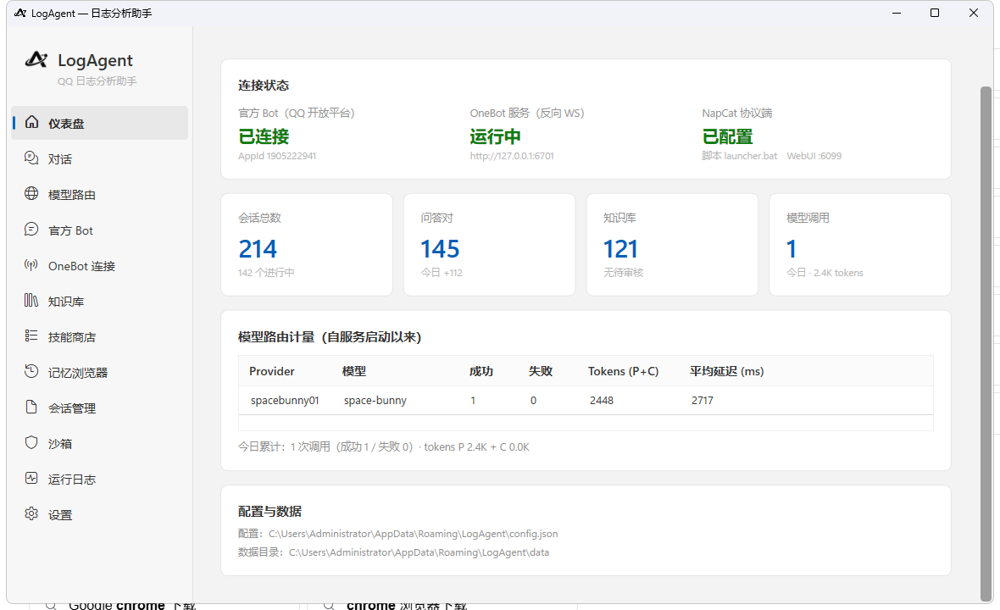

<div align="center">

# LogAgent for QQ（小炎）

**QQ 群 AI 日志分析助手** ｜ 给 Minecraft 玩家与群运维 ｜ @ 一下，拿到带行号证据的根因报告

[](https://github.com/anylyralabs/LogAgent-for-QQ/actions/workflows/ci.yml)
[](../../releases)
[](LICENSE)




简体中文（English 版筹备中）

</div>

> 把「贴日志 → 等人肉排障」变成「@ 一下 → 卡片报告」。以 Minecraft / 启动器 / 渲染器崩溃排障为主要场景，背后是带工具调用、知识库与学习记忆的多 Agent 系统，UI 为 WPF 托盘应用。

## 目录

- [功能特性](#-功能特性)
- [快速开始](#-快速开始)
- [安装与配置](#%EF%B8%8F-安装与配置)
- [用法示例](#-用法示例)
- [FAQ](#-faq)
- [项目结构](#-项目结构)
- [贡献](#-贡献)
- [许可证](#-许可证)

## ✨ 功能特性

- **日志理解工具链**：群文件 / LogShare 链接完整落盘（不省略中间），模型用 `read_file`（按行精读）、`search_file`（正则定位）、`run_shell`（白名单沙箱）自行取证，报告精确到行号
- **Plan-Execute + Reflection**：根因分析带自检评审；证据不足时列出还需补充的信息，不臆测
- **频道抽象（OpenClaw 风格）**：官方 Bot 优先，OneBot/NapCat 可并行；回复从原频道发出，按频道隔离、可扩展新平台
- **官方 Bot 增强**：Markdown 渲染（推荐用 ≤3 列小表格对比根因/证据，自动把 `【标题】` 转成 `## 标题`、内联 `【标签】` 转 `**标签**`，无权限自动回退纯文本）、分节合并为一条消息、主动消息与群聊主动消息（群聊需群主在 QQ 中开启）
- **合并转发卡片**：长报告按【结论】/【原因分析】/【解决方法】/【相关建议】分节渲染为一张转发卡片（OneBot），失败自动回退普通发送
- **知识库 + 学习记忆**：RAG 检索命中带引用编号回答；对话沉淀候选知识，审核后复用；会话自动切段摘要
- **多模态**：群里发崩溃截图，直接看图定位问题
- **技能系统 + MCP**：SKILL.md 指令型技能（渐进式披露）、HTTP 工具技能、标准 MCP 服务器
- **命令沙箱**：白名单 / 黑名单 + 超时杀进程树 + 全量审计 + 路径守卫
- **用量统计**：按日 × Provider × 模型 × 任务持久化聚合（上图仪表盘即真实数据）
- **多模型路由**：Provider 优先链 + 故障切换 + 熔断，任意 OpenAI 兼容端点

## 🚀 快速开始

**Windows 桌面版**

```bash
git clone https://github.com/anylyralabs/LogAgent-for-QQ.git
cd LogAgent-for-QQ
dotnet build LogAgent.slnx
dotnet publish src/LogAgent.App/LogAgent.App.csproj -c Release -r win-x64 --self-contained -p:PublishSingleFile=true
./publish/win-x64/LogAgent.App.exe
```

首次启动进入配置向导：填模型通道 → 选 QQ 接入方式 → 完成。

**Linux 无头版**（服务器常驻，详见 [Linux 部署](docs/05-Linux部署.md)）

```bash
dotnet publish src/LogAgent.Headless -c Release -r linux-x64 --self-contained -p:PublishSingleFile=true -o publish/linux-x64
./publish/linux-x64/LogAgent.Headless doctor     # 环境自检
./publish/linux-x64/LogAgent.Headless serve      # 常驻（SIGTERM 优雅退出）
./publish/linux-x64/LogAgent.Headless send group <group_openid> "维护公告"  # 主动推送
```

Linux 默认命令集是 POSIX shell（grep/sed/awk/find…），配置目录 `~/.config/LogAgent/`。

**跨平台桌面版**（Avalonia，Windows / Linux 通用）：

```bash
dotnet run --project src/LogAgent.Desktop
```

## ⚙️ 安装与配置

### 环境要求

| 依赖 | 要求 |
|------|------|
| 操作系统 | Windows 10 / 11（桌面版）；Linux x64/arm64（无头版） |
| .NET SDK | 10.0（仅构建需要；发布产物已内嵌运行时） |
| 模型端点 | 任意 OpenAI 兼容 API（本地代理 / 聚合平台 / 自建网关） |
| QQ 接入 | QQ 官方 Bot（优先）或 NapCat（OneBot 11），可同时启用 |

### 安装途径

- **源码构建**：见上方快速开始
- **二进制安装包**：见 [Releases](../../releases)（首次发布后提供，当前请走源码构建）

### 配置

模型通道在「模型路由」页添加，或直接编辑 `%AppData%\LogAgent\config.json`：

```jsonc
{
  "Providers": [
    {
      "Id": "my-model",
      "Endpoint": "https://<你的 OpenAI 兼容端点>/v1",
      "ApiKey": "<你的 API Key>",
      "ChatModel": "<模型 ID>",
      "ReasoningModel": false,
      "Enabled": true
    }
  ],
  "Rules": [
    { "TaskType": "Chat", "ProviderChain": ["my-model"] },
    { "TaskType": "LogAnalysis", "ProviderChain": ["my-model"] }
  ]
}
```

| 字段 | 含义 | 默认值 |
|------|------|--------|
| `Endpoint` | OpenAI 兼容 API 地址 | — |
| `ApiKey` | 鉴权密钥（仅存本机） | — |
| `ChatModel` | 模型 ID | — |
| `ReasoningModel` | 思考模型（推理 token 与输出共享预算，预算全量给足） | `false` |
| `ProviderChain` | 任务级 Provider 优先链，按序故障切换 | — |

QQ 接入推荐 **官方 Bot**（优先）：在 QQ 开放平台创建机器人后填 AppID / AppSecret，或在「官方 Bot」页扫码自动绑定。
**NapCat** 作为备用/增强通道：反向 WS 填 `ws://127.0.0.1:6701/onebot/v11/ws`（端口可在「OneBot11」页改）。
两者可以同时启用，官方 Bot 优先级更高：

```jsonc
{
  "Channels": [
    {
      "Id": "qq-official",
      "Type": "qq",
      "Name": "QQ 官方 Bot",
      "Transport": "official",   // official = QQ 官方 Bot（默认优先）
      "Enabled": true,
      "Priority": 100,
      "AppId": "<AppID>",
      "AppSecret": "<AppSecret>",
      "MarkdownSupport": true,   // 失败自动回退纯文本
      "MergeMessages": true      // 合并短时间内的连续群消息
    },
    {
      "Id": "qq-onebot",
      "Type": "qq",
      "Name": "QQ（NapCat / OneBot11）",
      "Transport": "onebot11",
      "Enabled": false,
      "Priority": 50,
      "OneBot11": { "Host": "127.0.0.1", "Port": 6701, "Path": "/onebot/v11/ws", "Token": "" }
    }
  ]
}
```

> 官方 Bot 主动消息：单聊/群聊都可发送。群聊需群主在 QQ 群设置中开启「机器人主动在群聊内发言」，
> 单聊还受用户在 QQ 中的主动消息开关与平台频控限制；被拒绝时运行日志会给出对应错误码。
> Markdown 需要开放平台权限；未开通时程序会自动回退纯文本，不会导致消息发不出去。
> 群聊开启「接收所有消息」后，普通群消息会作为上下文记录；短时间内的连续消息会合并成一次 Agent 轮次（`MergeMessages`）。

进阶配置（知识库、技能、MCP、沙箱白名单、触发规则）见 [docs/03-快速上手.md](docs/03-快速上手.md)。

## 💬 用法示例

群内 @ 机器人并发送日志链接：

```text
@小炎 https://logshare.cn/AbCdEf   这个崩了帮我看看
```

机器人：抓取日志全文落盘 → `search_file` 搜崩溃标记 → `read_file` 精读崩溃区段 → `run_shell` 命令交叉验证 → 回复合并转发卡片：

```text
📋 日志分析报告（文件：latest_game.log）      ← 卡片首页（概览）
 ├ 【结论】原生图形层段错误，崩在 libng_gl4es.so
 ├ 【原因分析】SIGSEGV @ 202906 行（附原文证据）…
 ├ 【解决方法】1. 切换渲染器 …
 ├ 【相关建议】…
 └ 【需要补充】hs_err_pid27662.log 完整堆栈
```

直接发崩溃截图也可以，机器人读图定位问题。

## ❓ FAQ

**Q1：机器人 @ 了没反应？**
A：看「仪表盘」连接状态与「运行日志」页。高频原因：NapCat 反向 WS 地址不对、消息未命中触发规则（默认需 @）、模型 Provider 熔断中。

**Q2：怎么换模型？**
A：「模型路由」页增删 Provider 并调整优先链，支持多厂商混布，切换无需重启。

**Q3：`run_shell` 会不会乱执行命令？**
A：沙箱默认启用——首 token 白名单（grep / findstr / type / python 等）、黑名单拦截危险命令、30 秒超时杀进程树、文件操作限制在数据目录内、全量审计。

**Q4：长回复为什么没变成卡片？**
A：合并转发卡片仅走 NapCat 通道；官方 Bot 会把同样分节的回复合并成一条 Markdown/文本消息发送。
回复需含 ≥2 个分节标题（【结论】等或独立成行的裸标题），否则按普通消息发送。

**Q5：数据都存哪？**
A：`%AppData%\LogAgent\`——`config.json` 配置、`data\` SQLite（会话/知识库/用量）、`files\` 群文件暂存（7 天自动清理）。密钥只存本机。

## 🧭 项目结构

```
LogAgent.App          WPF 主程序（Windows 桌面壳：托盘 / 向导 / 全部功能页）
LogAgent.Desktop      跨平台桌面壳（Avalonia：仪表盘 / 对话 / 模型路由 / 日志 / 设置）
LogAgent.Core         运行时组合根 AgentHost + AgentRuntime / GroupContextAgent / LogAnalysisAgent
LogAgent.Headless     无头宿主（Linux/服务器：serve / doctor / selftest / 知识库导入 / 训练导出）
LogAgent.Connections  频道管理器（ChannelManager）/ OneBot11Connection / OfficialBotConnection / QrConnect
LogAgent.Routing      多模型路由（优先链 + 熔断 + 计量事件）
LogAgent.Knowledge    知识库（RAG + 审核流）
LogAgent.Memory       会话存储 / 学习提炼 / 模型用量持久化
LogAgent.Skills       技能注册 + 内置工具宿主（read_file / search_file / run_shell）
LogAgent.Sandbox      命令沙箱（白名单 + 审计 + 路径守卫）
LogAgent.Shared       消息模型 / 配置 / 提示词 / Platform（shell 与路径规则抽象）
tools/  docs/         运维测试脚本 / 设计文档
```

设计细节见 [docs/](docs/)：[构建工作流笔记](docs/01-Agent应用构建工作流-学习笔记.md) · [日志分析 Agent 规划](docs/02-日志分析Agent应用规划.md) · [快速上手](docs/03-快速上手.md) · [分发与首启体验](docs/04-分发与首启体验.md) · [Linux 部署](docs/05-Linux部署.md)。

## 🤝 贡献

欢迎提 [Issue](../../issues) 反馈问题、[PR](../../compare) 参与开发；提交前请跑 `dotnet test` 确保用例通过。

## 📄 许可证

本项目（`linux` 分支）基于 **GNU General Public License v2.0** 发布，全文见 [LICENSE](LICENSE)。

- 你可以自由使用、修改、再分发，但**再分发时必须同样以 GPLv2 开放源码**，并提供完整对应源码；
- 分发二进制（含本项目的 Android APK）时，需随附获取对应源码的方式（见下）；
- 本项目同时包含少量第三方组件，各自的许可证见 `docs/07-第三方组件与许可证.md`。

**获取对应源码**：本仓库即为对应源码。若你收到的是二进制包（如 `LogAgent-android-arm64-*.apk`），
可在 [Releases](../../releases) 页面对应 tag 下取得该版本的完整源码，或向分发者索取。

> 说明：`main` 分支历史上曾以 MIT 发布，那部分历史提交仍按当时的 MIT 条款可用；
> 自 `linux` 分支起统一改为 GPLv2。

> ⚠️ 免责声明：本项目仅供学习研究。通过 NapCat 等非官方协议接入 QQ 存在账号风险，请自行评估；模型生成的内容不代表任何官方立场。

---

*最近更新：2026-10-17 · v0.7.0*
